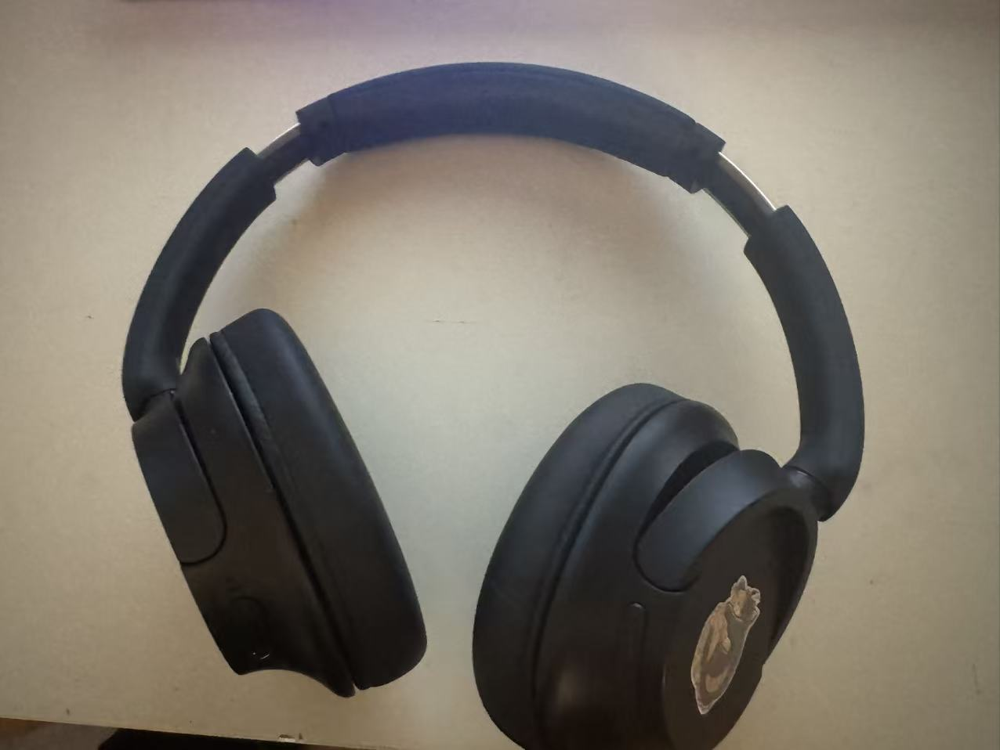
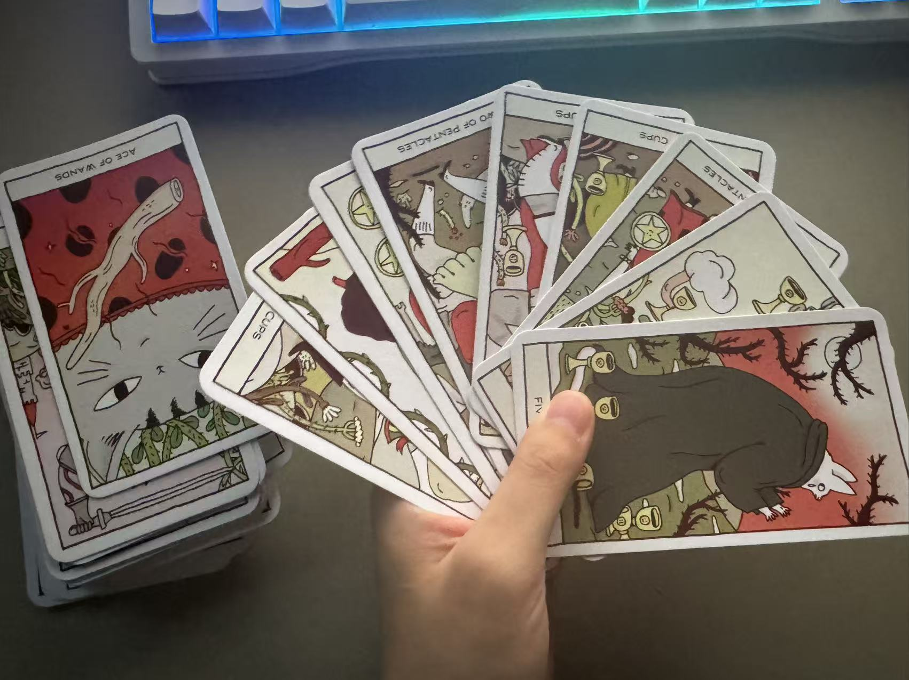
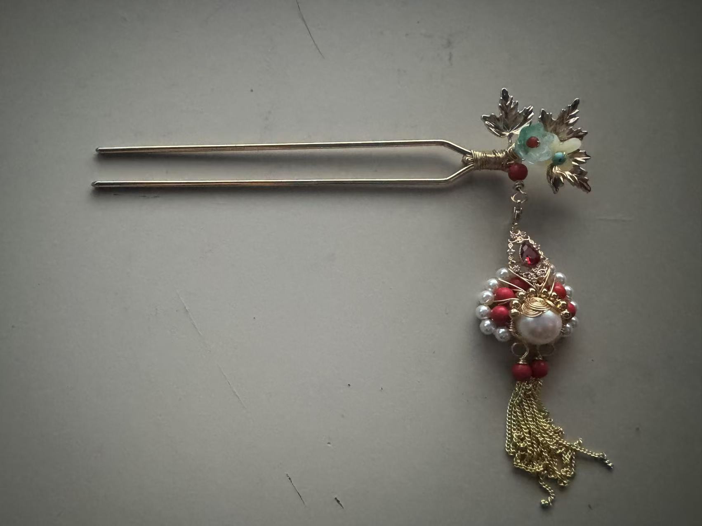
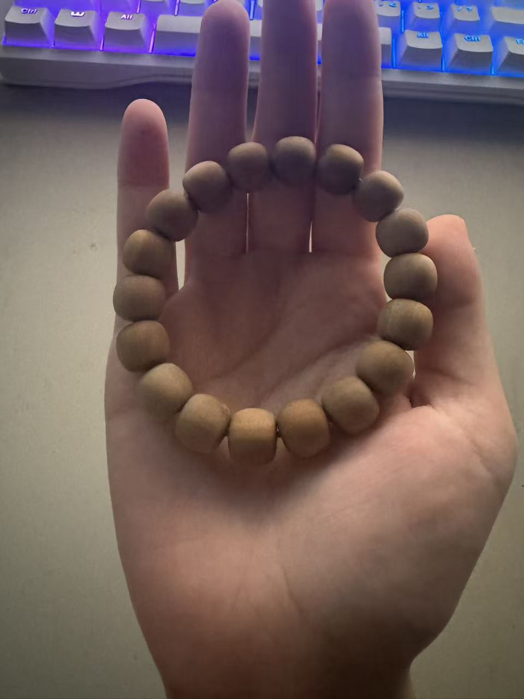

# Week 6 — Time Capsule: Objects & Memories

## Headphones

These headphones were a gift from my friend for my 22nd birthday. We met during our freshman year, and she is my best friend from college. Because I love listening to music, she gives me a pair of headphones or earphones every year. She once gave me a pair of cat-shaped Bluetooth earphones. When I used to see her wearing over-ear headphones, I always wondered why she chose them. Wouldn’t something like AirPods be more convenient? It wasn’t until she gave me a pair that I realized how comforting over-ear headphones could feel. I could also decorate them myself, and the battery lasts a long time.

I connected them to my computer, so I wear them almost whenever I use it, whether I’m doing homework, playing games, or making calls. I feel very focused when I wear them because it feels like someone is holding my head in their arms. Every time I use them, I think of my friend. They have become part of my daily life. If they break one day, I will buy an identical pair and pretend they never broke.

## Cat Tarot Cards

I bought these tarot cards in high school. I chose this version because I really like cats. During COVID, my mental health was not very good, and I used these cards countless times to ask what collage I would get into and whether things would go smoothly. These cards helped me a lot during that time.

## Peking Opera Hairpin

This hairpin was a birthday gift I received when I was very young. I brought it with me on my first trip to the United States in elementary school, but I left it at my uncle’ house. When I later came to the United States to study, I got it back. I feel that there is something special about how this childhood object found its way back to me.

## Wooden Bracelet

A friend from college gave me this wooden bracelet, and I always keep it with me. It has a natural wood scent that reminds me of my friend and the times we spent having fun together.
